# Notification Platform

A high-load notification service: push, email, SMS and in-app messages, sent immediately or scheduled, with user preferences, templates, retries, a dead-letter queue, bulk campaigns and delivery tracking. Written in Go on Kafka, DynamoDB and Redis.

Design target: 100M daily active users, 200M notifications per day (2.3K/s average, 23K/s peak), enqueue p95 under 100 ms, durable acceptance and at-least-once delivery.

| Read | For |
|---|---|
| This file | How it works, with diagrams. How to run it |
| [docs/decisions/](docs/decisions/README.md) | One file per design choice: why it was chosen and why it is better |
| [docs/observability.md](docs/observability.md) | Metrics catalogue, the Grafana dashboard, p50/p95/p99, alerts, traces |
| [docs/benchmarks.md](docs/benchmarks.md) | Measured results and what was not measured |
| [docs/kubernetes.md](docs/kubernetes.md) | Cluster manifests and scaling |
| [docs/architecture.md](docs/architecture.md) | The original design plan |

The diagrams below use Mermaid and render on GitHub and in most editors.

---

## 1. The system at a glance

Every arrow between boxes is either an HTTP call, a Kafka topic (rounded boxes) or a DynamoDB table (cylinders). Services never call each other directly except to providers.

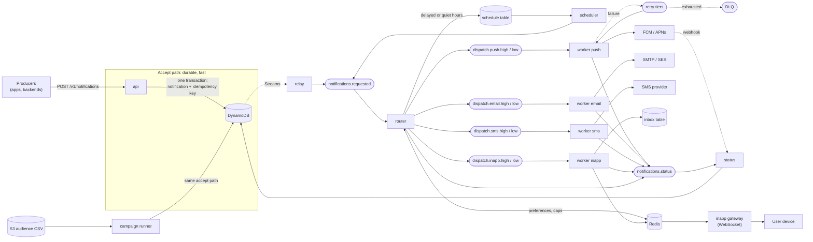

**Why it is shaped this way:** acceptance only needs DynamoDB, so the API stays fast and keeps working when Kafka or a provider is down. Everything after that is asynchronous and each stage can scale, fail and recover on its own. Details: [004 outbox](docs/decisions/004-transactional-outbox.md), [005 router and topics](docs/decisions/005-router-and-topic-layout.md).

---

## 2. Life of one notification

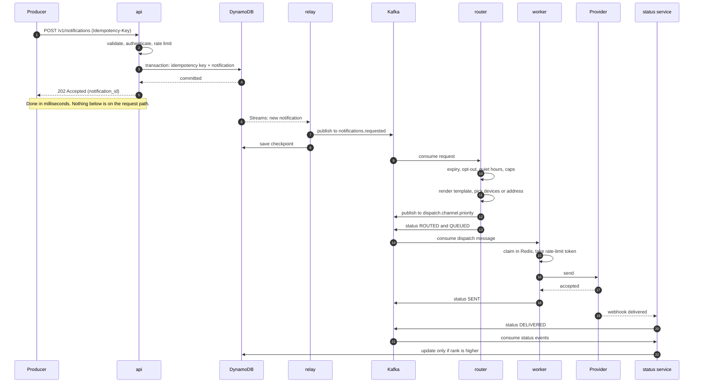

A producer sees only steps 1 to 6. A notification's current state is read with `GET /v1/notifications/{id}`, which shows overall and per-channel status.

---

## 3. The transactional outbox (no lost notifications)

Publishing to Kafka from the API would be a *dual write*: a crash between the database write and the publish loses or orphans a notification. Instead the API writes once, and a relay reads the database's own change stream.

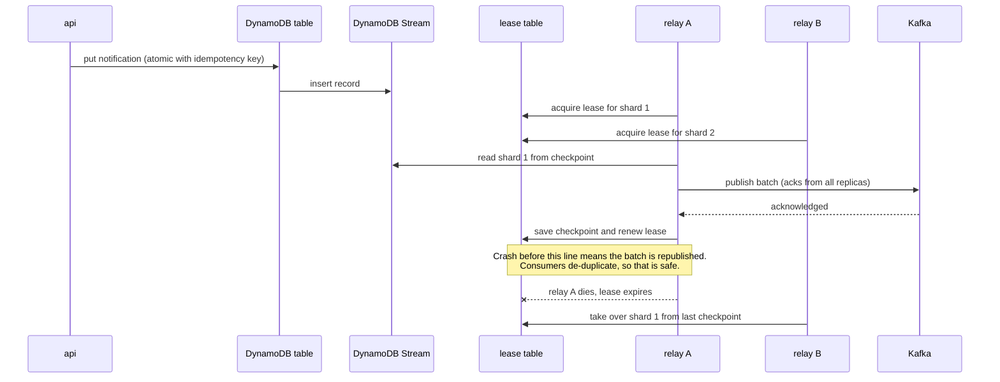

Several relays share the work by shard. Parent shards are finished before their children start. See [004](docs/decisions/004-transactional-outbox.md).

---

## 4. What the router decides

The router applies policy once so workers can stay simple. Each channel is decided independently.

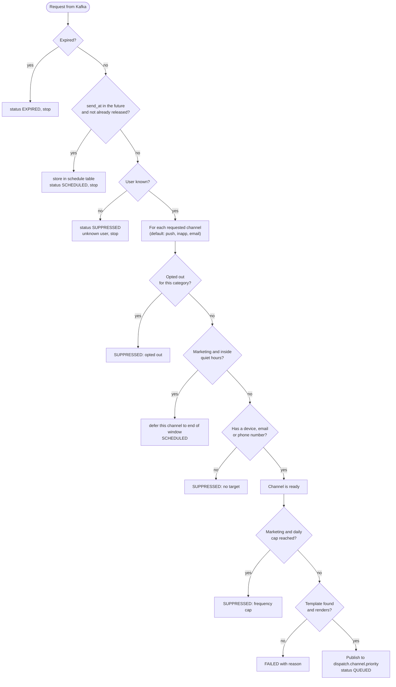

Transactional messages (codes, receipts) skip the quiet-hours and cap checks and use the high-priority lane. See [016](docs/decisions/016-policy-model.md).

---

## 5. What a worker does, and how failures are handled

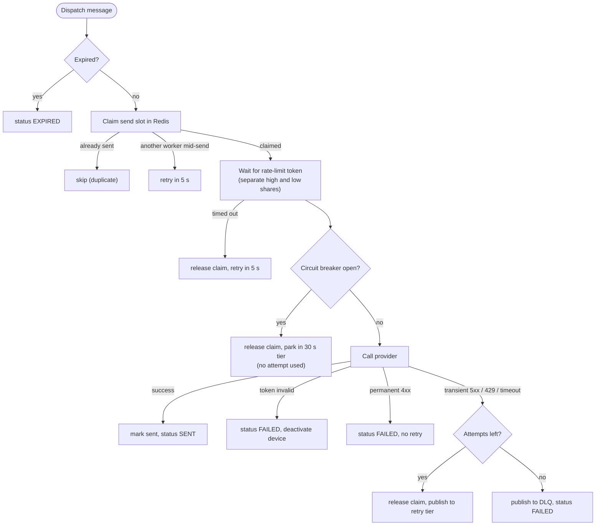

The retry tiers are separate topics, so a failing message never blocks the partition it came from:

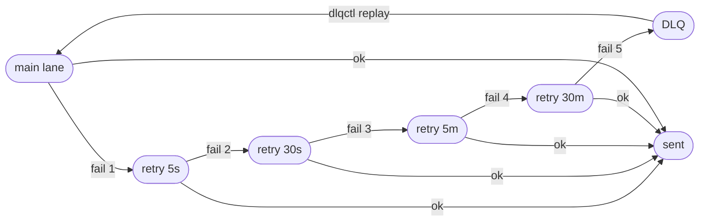

See [006](docs/decisions/006-retry-tiers-and-dlq.md) and [007](docs/decisions/007-idempotency-and-dedupe.md).

---

## 6. Status of a notification

Each channel has its own status. A status only moves to a higher rank, so late or duplicate events cannot move it backwards.

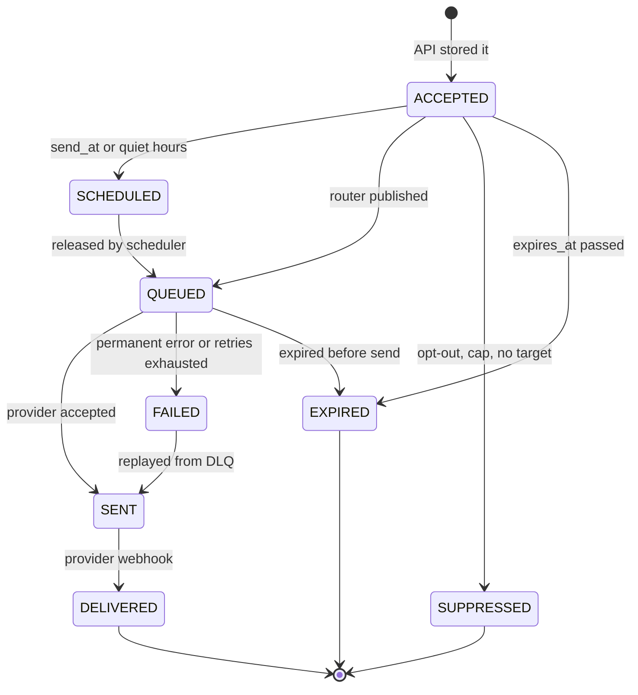

`SENT` is final for email, because SMTP gives no delivery receipt. In-app is marked `DELIVERED` when stored. See [010](docs/decisions/010-status-as-events.md).

---

## 7. Scheduling

Delayed notifications are stored by due time in sharded one-minute buckets, so a burst at 09:00 spreads over many partitions instead of one.

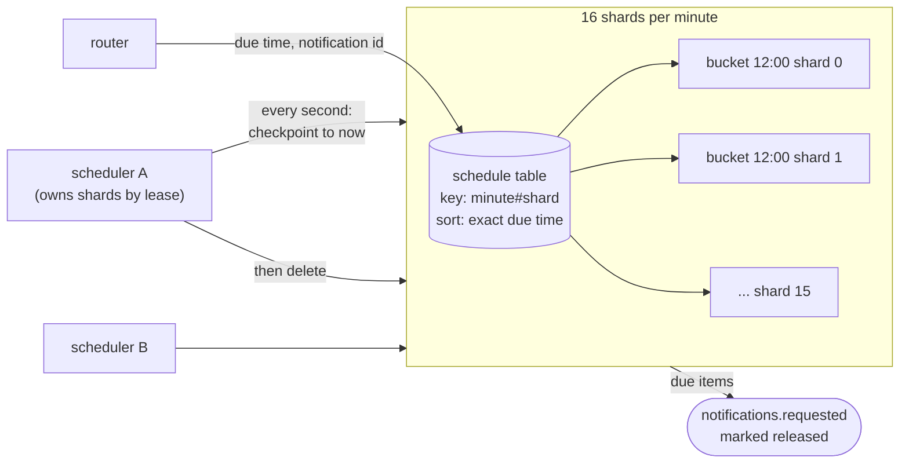

After downtime a scheduler resumes from its saved checkpoint and replays every missed minute. See [009](docs/decisions/009-scheduler.md).

---

## 8. Bulk campaigns

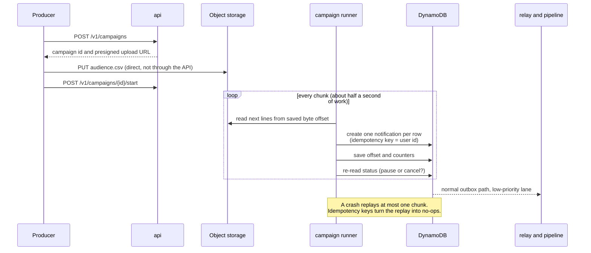

See [012](docs/decisions/012-campaigns.md).

---

## 9. In-app messages and live push

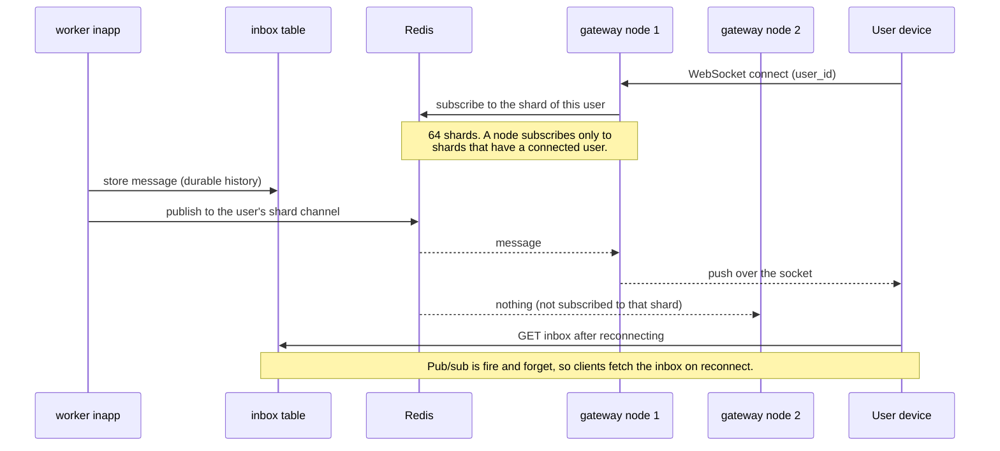

See [011](docs/decisions/011-inapp-delivery.md).

---

## 10. Data model

DynamoDB tables (on-demand). Tables for users hold several kinds of item under one partition key so the router loads a user in a single query.

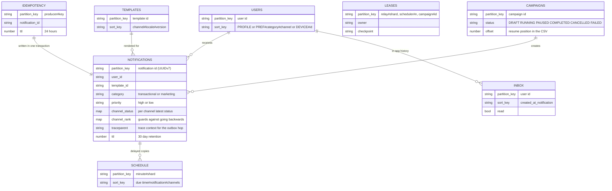

---

## 11. Kafka topics

Messages are keyed by `user_id`, so one user's messages stay in order within a partition. Counts are partitions.

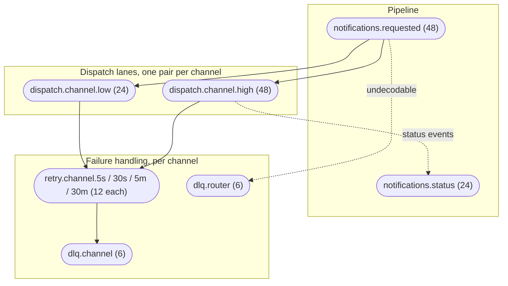

Channels are push, email, sms and inapp, which gives 31 topics in total. Consumers can scale up to the partition count and no further. See [002](docs/decisions/002-kafka.md).

---

## 12. Observability

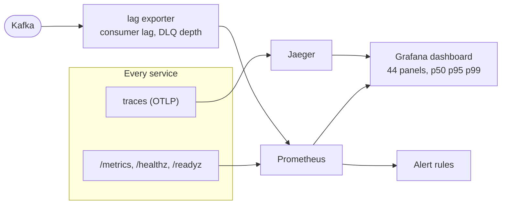

One notification is one trace, carried across the DynamoDB Streams hop and every Kafka hop:

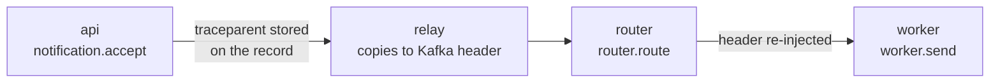

Everything about metrics and alerts is in [docs/observability.md](docs/observability.md).

---

## 13. Scaling and deployment

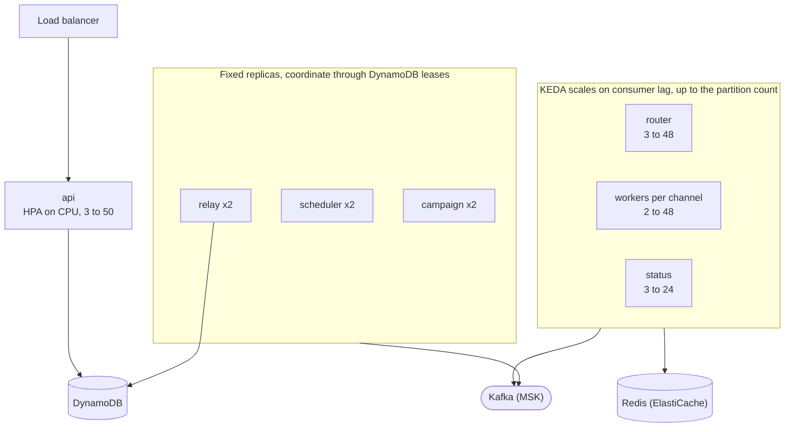

The Kubernetes manifests render and pass consistency tests but have not been applied to a cluster. See [docs/kubernetes.md](docs/kubernetes.md) and [015](docs/decisions/015-kubernetes.md).

---

## Run it locally

Requires Go 1.26 and Docker.

```sh
make up        # Kafka (3 brokers), DynamoDB Local, Redis, Mailpit, S3Mock, Prometheus, Grafana, Jaeger
make migrate   # tables, topics, bucket
make run       # builds and starts all 13 processes, logs in .run/
curl -XPOST localhost:8081/v1/notifications -H 'Authorization: ApiKey demo-key' \
  -H 'Idempotency-Key: k1' -d '{"user_id":"u1","template_id":"welcome","category":"transactional","data":{"name":"Dias"}}'
make stop
make test      # unit and integration tests (integration tests skip without the compose stack)
```

| Service | Ports (service / metrics) |
|---|---|
| api | 8081 / 9101 |
| relay, router, scheduler | - / 9102, 9103, 9106 |
| status (webhooks) | 8082 / 9107 |
| inapp (WebSocket) | 8083 / 9108 |
| workers push, email, inapp, sms | - / 9104, 9114, 9124, 9134 |
| campaign, lagexporter, mockprovider | - / 9109, 9110, 9105 (provider 9200) |

Tools: Grafana :3000, Prometheus :9090, Jaeger :16686, Mailpit :8025, Kafka UI :8090, DynamoDB admin :8001. Host ports 6380 (Redis) and 9300 (S3) are shifted from the defaults to avoid clashing with other local software.

Other commands: `make loadtest`, `make chaos`, `make images`, `make k8s-test`, `python3 scripts/gen_dashboard.py`, `python3 scripts/check_dashboard.py`.

## API

All routes need `Authorization: ApiKey <key>`.

| Method and path | Purpose |
|---|---|
| `POST /v1/notifications` (`Idempotency-Key` header) | Accept one notification, returns 202 |
| `POST /v1/notifications/batch` | Up to 1000, per-item results |
| `GET /v1/notifications/{id}` | Overall and per-channel status |
| `PUT /v1/users/{id}`, `PUT /v1/users/{id}/preferences` | Profile, per category and channel preferences with quiet hours |
| `POST /v1/users/{id}/devices`, `DELETE .../devices/{device_id}` | Push tokens |
| `POST /v1/templates` | New template version (per channel and locale) |
| `GET /v1/users/{id}/inbox`, `POST .../inbox/{item}/read` | In-app inbox |
| `POST /v1/campaigns`, `GET/POST /v1/campaigns/{id}[/start,pause,resume,cancel]` | Bulk campaigns, audience CSV uploaded to a presigned URL |
| `POST /v1/webhooks/{provider}` (status service, `X-Webhook-Key`) | Provider delivery callbacks |
| `GET /v1/ws?user_id=` (inapp service) | Live in-app messages |

## Not done, and what I would improve

Real providers are not implemented: push, SMS and email go to the mock provider and Mailpit. PII and device tokens are stored unencrypted. Kubernetes manifests were never applied to a cluster. The 23K/s peak, a 30 minute soak, a Redis restart and a campaign plus transactional mix were not tested (see the benchmark report for what was).

Recommended next steps, most valuable first:

1. **Cut status event amplification.** Each notification emits about 8 status events; at 23K/s that is roughly 180K events/s into DynamoDB, and it was the first thing to fall behind in testing. Drop the per-channel `QUEUED` event, coalesce in the worker, batch writes, or move the event stream to a store built for appends.
2. **Remove the batch barrier in consumers.** A batch waits for its slowest message before the next poll. Pipelining per partition would raise worker throughput without more pods.
3. **Reconcile notifications stuck at `SENT`.** If a provider callback never arrives, nothing ever marks the notification final. Add a sweeper that moves old `SENT` records to an explicit unknown state and alerts on the count.
4. **Put user-scoped auth in front of inbox and WebSocket.** They currently take a producer API key, which is fine server-to-server but must not reach mobile clients; issue short-lived per-user tokens.
5. **Decide the failure policy for Redis.** Dedupe and rate limiting both depend on it, so an outage halts sending (fail-closed). That is safe against duplicates but may be wrong for OTP traffic.
6. **Idempotency keys expire after 24 hours.** A campaign resumed after that can send again; extend the TTL for campaign keys.
7. **Consumer scaling stops at the partition count** (48 on the hot topics). Plan repartitioning before traffic nears that.
8. **Add jitter to retry delays** so that messages that failed together do not retry together.
